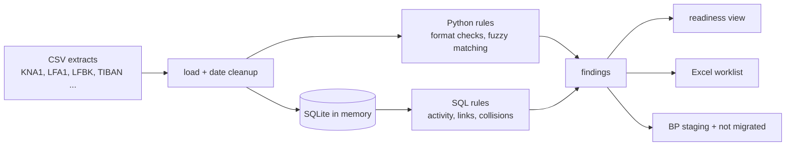
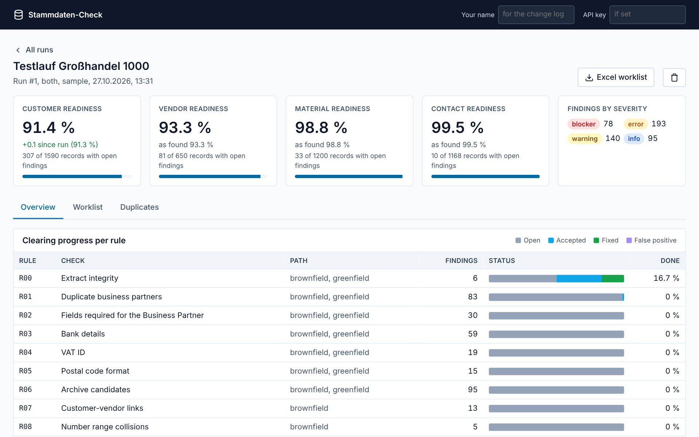
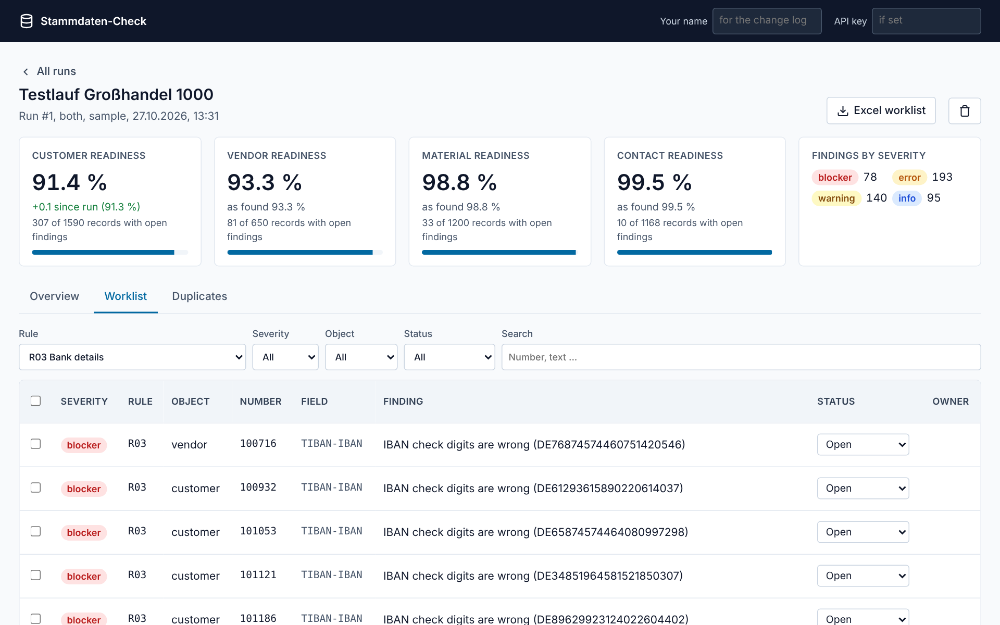
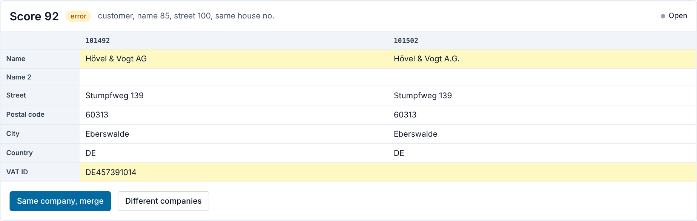

# stammdaten-check

All data in this repo is synthetic, generated by `stammdaten_check/generator.py`. No customer data was used.

**Kurzfassung (DE).** Ein Prüfwerkzeug für Kunden-, Lieferanten- und Materialstammdaten vor dem Umstieg von SAP ECC auf S/4HANA. Es liest Tabellenauszüge (KNA1, LFA1, LFBK, TIBAN, BNKA, KNVK, MARA, MAKT), prüft 14 Regeln von Dubletten über CVI-Verknüpfungen bis zur E-Rechnungs-Fähigkeit und erzeugt eine Klärungsliste in Excel. Im Web-Dashboard arbeiten die Fachbereiche die Befunde ab, jede Statusänderung wird protokolliert. Für eine Neueinführung entsteht zusätzlich eine bereinigte BP-Staging-Datei. Läuft lokal, ohne SAP-Zugang und ohne Cloud.

## Why

Plenty of Mittelstand companies still run SAP ECC, and the move to S/4HANA keeps getting pushed back. One reason is master data. Customers entered twice, vendors with an IBAN that fails its own check digits, customer and vendor records of the same company that were never linked. In ECC nobody noticed. In a system conversion the customer/vendor integration (CVI) stops on exactly these records.

Large projects buy data quality tools for this. Smaller ones export everything to Excel and filter by hand for weeks. I wanted something in between: a set of checks that a consultant or a key user can run on table extracts in a few seconds and hand to the business as a worklist.

I learned the SAP side in my SAP consultant training. This project is where I tried to turn that into something that works on data.

## What it checks

| Rule | Check | Path |
|---|---|---|
| R00 | The extract itself: duplicate keys, company code rows without a master record | both |
| R01 | Duplicate customers and vendors (fuzzy name, address, VAT ID) | both |
| R02 | Fields a Business Partner cannot exist without (placeholders like "xxx" count as empty), account group mapped to a BP grouping | both |
| R03 | Bank data: IBAN check digits and length, bank key in BNKA, German IBAN matches BLZ and account | both |
| R04 | VAT ID format per country, German check digit, optional live check at EU VIES | both |
| R05 | Postal code format per country | both |
| R06 | Archive candidates: no postings for 3 years and nothing open | both |
| R07 | Customer-vendor links that are broken or missing | brownfield |
| R08 | Customer and vendor with the same number but different companies | brownfield |
| R09 | Form of address values without a BP title mapping | brownfield |
| R10 | Deletion flag set on partners that are still in use | both |
| R11 | E-invoice readiness: tax ID, invoice email, Leitweg-ID for public customers | both |
| R12 | Contact persons that cannot become person BPs | brownfield |
| R13 | Materials: base unit in T006, descriptions in required languages | both |

Brownfield means a system conversion, where every customer and vendor has to become a BP inside ECC before the conversion runs. Greenfield means a new system loaded through the Migration Cockpit, where old links do not matter. Pick one with `--path`. Details for every rule, including the SAP fields, are in [docs/rules.md](docs/rules.md).

## Quick start

Python 3.11 or newer.

```bash
python -m venv .venv && source .venv/bin/activate
pip install -e .

stammdaten-check generate --out data/sample      # fake ECC extracts with planted errors
stammdaten-check run --input data/sample --out out
stammdaten-check evaluate --input data/sample --out out
```

A run over about 1,600 customers, 650 vendors and 1,200 materials takes under a second.

To use your own data, export the tables listed in [docs/data-model.md](docs/data-model.md) as CSV (SE16N works) and point `--input` at the folder.

## What you get

- `stammdaten-report.xlsx` with a summary per object, a worklist with empty status, owner and comment columns, duplicate pairs side by side, and a sheet that explains each rule
- `findings.csv` with every finding, for anyone who wants to load it somewhere else
- `bp_staging_customer.csv` and `bp_staging_vendor.csv`: records ready for a greenfield load, shaped like the Migration Cockpit templates (flattened, not the official XML file)
- `not_migrated.csv`: every record left out and the reason (deletion flag, archive candidate, duplicate, blocker)
- `summary.json` with readiness per object and run times per rule

Readiness is `100 * (1 - average penalty)`, where each record takes the penalty of its worst finding: blocker 1.0, error 0.6, warning 0.25, info 0. The calculation is a plain SQL view in [sql/readiness.sql](sql/readiness.sql).

## How it works



Format checks and fuzzy matching are in Python. Anything that is really a join or an aggregate (last posting, broken links, number collisions, the score) is SQL in the [sql](sql) folder, so you can read the logic without reading the code.

Duplicate matching uses blocking. Comparing every customer with every other one would be 1.26 million pairs. The tool only compares partners that share a postal code, a VAT ID, the start of the name in the same city, or street and house number. That brings it down to about 43,000 pairs and 0.02 seconds.

## Dashboard and API

A worklist in Excel works until three departments edit three copies. The dashboard keeps one list: every finding has a status (open, accepted, fixed, false positive), an owner and a comment, and every change lands in a history with name and time.

```bash
stammdaten-check serve
# Dashboard  http://127.0.0.1:8000
# API docs   http://127.0.0.1:8000/docs
```



- **Overview**: readiness per object twice, as found and now. Fixed findings and false positives stop counting, so the number moves while the business works.
- **Worklist**: filter by rule, severity, object, status or text. Select rows and change them together.
- **Duplicates**: both records side by side, differing fields marked, one click for "same company" or "different companies". A false positive always needs a reason.





The API is what the dashboard uses, and what other tools can call:

| Method | Path | What it does |
|---|---|---|
| POST | /api/v1/runs | new run from a zip of CSV extracts, or `sample=true` |
| GET | /api/v1/runs/{runId} | readiness then and now, progress per rule |
| GET | /api/v1/runs/{runId}/findings | filtered, paged findings |
| GET | /api/v1/runs/{runId}/duplicate-pairs | both records per duplicate finding |
| GET | /api/v1/runs/{runId}/report | Excel worklist with current statuses |
| PATCH | /api/v1/findings/{findingId} | status, owner, comment, logged |
| PATCH | /api/v1/findings | the same for up to 500 findings, all or nothing |
| POST | /api/v1/partner-checks | check one new or changed partner: fields, duplicates, IBAN already in use |
| GET | /api/v1/vendors/{vendorId} | vendor as on file: address, phone, email, bank accounts |

The last two are the hooks for onboarding. Before a vendor is created or its bank details change, a workflow sends the data here and gets back problems, likely duplicates, other partners that already use the same IBAN, and the record on file. [vendor-guard](https://github.com/abdallahaneed/vendor-guard) does exactly that.

Writes need the `X-API-Key` header once `STAMMDATEN_API_KEY` is set. Reads stay open, because the tool is meant to run on localhost or inside a company network. Uploads only take CSV files out of the zip, by file name, so a path inside the archive cannot write outside the run folder.

With Docker:

```bash
STAMMDATEN_API_KEY=choose-one docker compose up --build
```

## Results on the synthetic data

The generator plants a known set of errors and writes them to `labels.csv`. Some of them are holdout variants the rules were not tuned on: umlauts written out, other spellings of the legal form, swapped digits, a district name in the city field. After I changed the matching (see [docs/decisions.md](docs/decisions.md)), I tested on two seeds I had not looked at before.

| Seed | R01 planted | found | false positives | precision | recall | holdout recall |
|---|---|---|---|---|---|---|
| 7 | 79 | 78 | 5 | 0.94 | 0.99 | 0.97 |
| 2024 | 79 | 79 | 5 | 0.94 | 1.00 | 1.00 |

Be careful with these numbers. The same person wrote the error generator and the rules. All exact checks (R00, R02 to R13) find 100 % of planted errors on every seed, which only proves the checks do what they say. It says nothing about errors I did not think of. R01 is the one worth looking at:

- The miss on seed 7 is `Schaaf UG (haftungsbeschränkt)` against `SchaafU G (haftungsbeschränkt)`. A typo that runs into the legal form breaks the legal form detection and the name score drops to 34. I left it in.
- The 5 false positives on each seed are planted on purpose: branches of one company with the same VAT ID in another city. They come out as "review", not as duplicates. In real data some of those are ship-to accounts that should stay.

## Known limitations

- No real SAP data. Table and field names follow ECC, but real extracts will have surprises my generator does not produce.
- R03 checks IBAN structure, not whether the account exists. That needs a bank or a payee verification service.
- The German BLZ check digit methods (over 100 of them) are not implemented. The IBAN check covers most typos anyway.
- Weights in the duplicate score were set by judgment and a few test runs, not fitted on labeled real data.
- The BP staging file is a flattened version of the Migration Cockpit template. You still have to move the data into the official file.
- The tax number categories in `staging.py` (`DE0`, `AT0` ...) need checking against your system's customizing.
- VIES is off by default. It is slow and member state services go down regularly.
- The dashboard has no user login. The name in the header is what goes into the history, nothing checks it. Fine for a project team on one machine, not for a company-wide rollout.

## Layout

```
stammdaten_check/   engine, rules, matching, generator, Excel report, staging export
  web/              FastAPI app, SQLite store, partner check, dashboard (plain HTML/CSS/JS)
sql/                set-based checks and the readiness view
reference/          customizing as CSV: postal code rules, units, CVI grouping, form of address
config/default.toml thresholds, cutover date, path
docs/               rules, data model, decisions
tests/              pytest
```

## Tests

```bash
pip install -e ".[dev]"
pytest
```

## License

MIT
